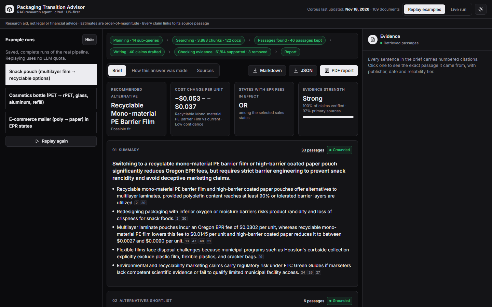
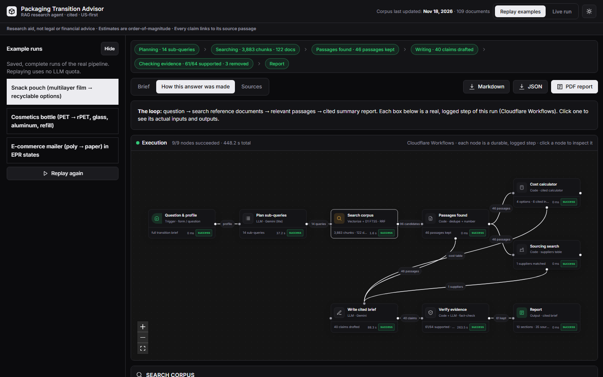
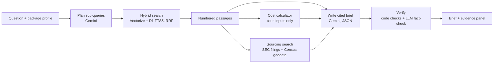

# Packaging Transition Advisor

**Live demo:** https://packaging-transition-advisor.pta-worker.workers.dev (opens in replay mode; no account or key needed)

## What it does, in 30 seconds

A company asks: *"What happens if we move our packaging to a sustainable alternative?"*

This tool answers the way a careful analyst would:

```
your question  →  search a library of dated public documents  →  pull out the relevant passages  →  write a short report where every sentence cites its passage
```

The library holds about 110 curated public sources: state packaging laws, the FTC Green Guides, city recycling program lists, open-access research papers, SEC filings, official trade price statistics, and producer fee schedules. Every sentence in the report links to the exact passage it came from (publisher, date, reliability tier). When the documents do not cover something, the report says so instead of guessing.

On top of that loop: a **cost calculator** (deterministic code fed only by cited numbers), a **sourcing search** (suppliers and US plant locations from SEC filings), and a **verification pass** that removes any claim its cited passage does not support.



## What you get

Describe a package (or just ask a question) and pick a workflow:

| Workflow | Output |
|---|---|
| Full transition brief | Product & current packaging, alternatives with fit ratings, state-by-state regulation (map + timeline), end-of-life reality check, green-claims risk, supply chain, cost range table, supplier shortlist + plant map, competitor context, evidence gaps |
| Free question | The core research agent: a short cited answer |
| Regulatory scan · Alternatives fit · End-of-life check · Green-claims check · Cost estimate · Competitor scan · Sourcing search · Market entry overview | One focused part of the brief |

Every section carries a label: **Grounded** (every claim supported), **Partial** (some claims removed or flagged), or **Evidence Gap** (the corpus cannot answer). Exports: Markdown, JSON (full run), and a print-ready PDF report.

The **How this answer was made** tab shows the real run as a workflow: each node is a logged step (plan → search → passages → cost / sourcing → write → verify → report) with its actual inputs and outputs.



## How it works



Everything runs on Cloudflare's free tier: Workers (API + site), Workflows (each step durable and logged), D1 (documents, chunks, keyword index, structured tables), Vectorize (embeddings), Workers AI (`bge-small-en-v1.5` embeddings). Gemini's free tier writes the reports. **Running cost: $0/month** (see [DECISIONS.md](docs/DECISIONS.md) D1). More in [ARCHITECTURE.md](docs/ARCHITECTURE.md).

## Evaluation

45 hand-written questions, including 5 trick questions the corpus cannot answer. Results, with weaknesses, are in [EVALUATION.md](docs/EVALUATION.md); the with-retrieval vs. without-retrieval comparison is in [CASE_STUDY.md](docs/CASE_STUDY.md).

## Limitations

- Cost figures are rough ranges from public data (trade-statistics unit values, producer fee schedules), not supplier quotes.
- State laws change quickly; the corpus date limits accuracy (the header shows when it was last updated).
- Paid market reports and some sites (bot-protected or restrictive terms) are link-only: title, date and link, no text.
- Free LLM tiers have rate limits; the public demo opens in replay mode and live runs are capped per visitor per day.
- Supplier lists come from public SEC filings; capability and pricing must be verified directly.
- Not legal advice.

## Setup (new machine or new Cloudflare account)

Requirements: Node 20+, Python 3.11+, git. Everything else installs from the repo.

```bash
git clone https://github.com/robbiecharlesschwartz-sudo/packaging-transition-advisor
cd packaging-transition-advisor
pip install -r requirements.txt
cd worker && npm ci && cd ../app && npm ci && cd ..
cp .env.example .env            # set ADMIN_TOKEN (any long random string) and WORKER_URL
```

**Use the existing deployment** (same Cloudflare account): `cd worker && npx wrangler login`, then `npm run build --prefix app && npx wrangler deploy` from `worker/`. The Worker already holds `GEMINI_API_KEY` and `ADMIN_TOKEN`; put the same `ADMIN_TOKEN` in `.env`.

**Fresh Cloudflare account:**

1. `npx wrangler d1 create pta-db` and paste the id into `worker/wrangler.jsonc`.
2. `npx wrangler vectorize create pta-chunks --dimensions=384 --metric=cosine`, then create metadata indexes for `layer`, `jurisdiction`, `license`, `reliability` (string) and `year` (number): `npx wrangler vectorize create-metadata-index pta-chunks --propertyName=layer --type=string` (and so on).
3. `npx wrangler d1 migrations apply pta-db --remote`
4. Secrets: `python scripts/set_secret.py ADMIN_TOKEN --worker` and `python scripts/set_secret.py GEMINI_API_KEY --worker` (or paste into `PASTE_KEY_HERE.txt` and run `python scripts/upload_key_file.py GEMINI_API_KEY`). The Gemini key must come from an AI Studio project **with no billing attached** to stay on the free tier.
5. Build and deploy: `npm run build --prefix app && cd worker && npx wrangler deploy`
6. Load the corpus: `python scripts/fetch.py && python scripts/fetch_special.py all && python scripts/parse.py && python scripts/chunk.py && python scripts/build_price_inputs.py && python scripts/build_suppliers.py && python scripts/embed.py && python scripts/load_structured.py`
7. GitHub repo secrets for the scheduled jobs: `WORKER_URL`, `ADMIN_TOKEN` (Settings → Secrets and variables → Actions).

## Local development

```bash
cd worker && npx wrangler d1 migrations apply pta-db --local
python scripts/build_local_seed.py && npx wrangler d1 execute pta-db --local --file ../corpus/processed/local_seed.sql
npx wrangler dev                 # API on :8787 (local D1, remote Vectorize + Workers AI); needs worker/.dev.vars with GEMINI_API_KEY and ADMIN_TOKEN
npm run preview:built --prefix app   # site on :5173, proxies /api to :8787
```

Windows: if the checkout path is very long, map a short drive (`subst P: <path>`) and pass `--persist-to` a short folder to `wrangler` (see [FIXED_BY_HAND.md](docs/FIXED_BY_HAND.md) #17).

Useful scripts: `scripts/ask.py "query"` (print top retrieved chunks), `scripts/run_brief.py <workflow> --profile p.json` (run end to end), `eval/run_eval.py`, `scripts/acceptance.py [--live] [--repair]`.

## Keeping it healthy

| Job | Where | What |
|---|---|---|
| Weekly corpus refresh | Worker Cron Trigger + `.github/workflows/refresh.yml` | new news items, latest PPI, page-change checks; full re-fetch/re-embed of changed documents; `corpus/CHANGELOG.md` |
| Uptime check | `.github/workflows/keepalive.yml` | fails (emails the owner) if the site or API stops responding |
| Self-check | `.github/workflows/selfcheck.yml` | runs the acceptance suite with safe auto-repairs; opens an issue if anything still fails |
| CI | `.github/workflows/ci.yml` | calculator tests (Python + TypeScript on the same cases), typecheck, front-end build, citation check |
| Eval | `.github/workflows/eval.yml` | the 45-question evaluation on demand |

## Repository map

```
corpus/      sources.csv (every source, dated + licensed), structured/ (fees, laws, suppliers, prices), ingest_report.md
scripts/     fetch → parse → chunk → tag → embed; price/supplier builders; refresh; acceptance; CLIs
cost/        geometry.py, calculator.py, price_inputs.json (every value cited), tests/
workflows/   10 workflow definitions (YAML: filters, prompts, output schema, sections)
pipeline/    steps.ts: the named steps shared by the Workflow and the node-graph view
worker/      Cloudflare Worker + Workflow (API, retrieval, LLM, verification, cost, sourcing, cron)
app/         React + Vite front end
eval/        questions.yaml, run_eval.py, results/
docs/        ARCHITECTURE, DECISIONS, FIXED_BY_HAND, EVALUATION, CASE_STUDY, ACCEPTANCE, screenshots/
```

MIT licensed. An independent project.
