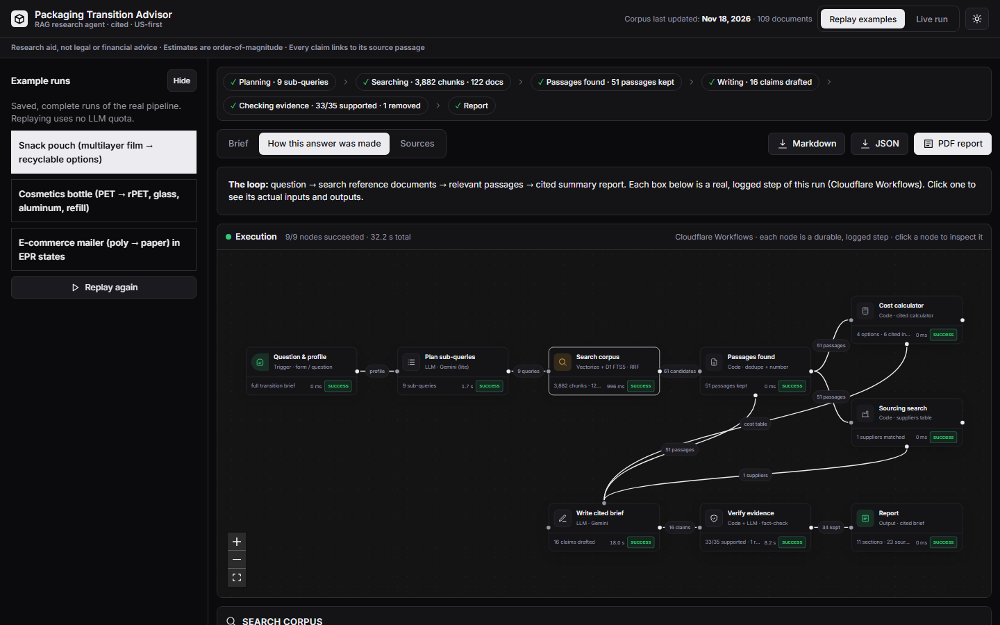

# Case study: a research agent for sustainable-packaging decisions

**Demo:** https://packaging-transition-advisor.pta-worker.workers.dev (replay mode, no login)

## 1. The problem

A client asks: *"What happens if we move our packaging to a sustainable alternative?"* Answering it well means pulling together state packaging laws (seven states now have producer-responsibility laws, each on its own timeline), whether a material is actually accepted for recycling where the product is sold, what can legally be said on the pack, what the switch costs, and who can supply it. An analyst typically spends days collecting this by hand, and a generic chatbot answers instantly but cannot be trusted on the specifics.

## 2. The approach

A research agent over a curated, dated library of ~110 public documents (statutes, agency pages, city recycling lists, producer fee schedules, SEC filings, official trade price statistics, open-access research). It answers only from those documents, cites every sentence, and says plainly when the documents do not cover something.

```
question  →  search the documents  →  keep the relevant passages  →  cited report (+ "what we could not answer")
```

Three layers sit on that loop:

1. **Cost calculator** — deterministic code; every input (price per kg, fee per lb, density, container weight) quotes a corpus passage, and the build fails if a quote cannot be found.
2. **Sourcing search** — suppliers and US plant locations from SEC filings, ranked by material match and distance to the client's sales states.
3. **Verification** — code checks that every number appears in a cited passage, then a second model pass fact-checks each claim; unsupported claims are removed and listed.

## 3. How it works



Each box is a real, logged step of the run (Cloudflare Workflows); the site lets a reader click any step to see its inputs and outputs. Everything runs on free tiers ($0/month).

## 4. Proof

### Evaluation (45 hand-written questions)

| Metric | Result |
|---|---|
| Answer correctness (exact) | 44 / 45 (98%) |
| Retrieval recall (expected source retrieved) | 29 / 29 (100%) |
| Gap honesty (5 trick questions the corpus cannot answer) | 5 / 5 |
| Cost math (worker output = hand-checked calculator) | 6 / 6 |
| Citation precision (strict lexical check) | 73 / 111 (66%) |

Details: [EVALUATION.md](EVALUATION.md). Honest weaknesses:

- **Citation precision is the soft spot.** The check is deliberately strict (most content words of a claim must appear in its cited passage), so paraphrases and claims that combine two passages fail it. Some failures are real: a claim cited to a neighboring passage of the right document. The pipeline's own fact-checker is more lenient; the gap between the two is the next thing to tighten.
- **One miss (R10, Maine's $500 low-volume flat fee):** the right statute was retrieved but the writing step returned nothing for that run (a free-tier model failure), so the answer was an empty Evidence Gap. The system failed safe, but it should retry.
- **Free-tier limits shape quality.** When the main model's daily quota runs out, writing falls back to a lighter model, which produced filler ("requirements are being developed") that the verifier then removed. The output stays honest but gets thinner.

### With retrieval vs. without

Same model, same three client profiles; the baseline has no documents ([eval/results/baseline/](../eval/results/baseline/)).

| | Baseline (no retrieval) | This system |
|---|---|---|
| **Maine's packaging law** | "Maine (LD 1535)" | 38 M.R.S. §2146 (PL 2021 c. 455), cited to the statute text |
| **Maryland** | "Maryland (HB 980)" | SB 901 (2025), cited to the bill |
| **Washington** | Lists the recycled-content law (SB 5022) as its packaging law | Recycling Reform Act (SB 5284): statewide curbside services begin 2030, cited to Ecology |
| **Oregon fees** | "Uncoated paper mailers will incur significantly lower PRO fees" | The actual 2025 schedule: PE film 55¢/lb, kraft paper 4¢/lb, plastic laminates 114¢/lb, cited to CAA's annual report pp. 59–60 |
| **Costs** | "Current multilayer laminate: $0.080–$0.095 per unit" (no source) | $0.099–$0.109 per unit, every input cited (US import unit values for the material, Oregon fee, the client's own weight) and labelled Low/Medium confidence |
| **Recycling claims** | "Recycling rates for plastic films remain under 10%", ">70% recovery" (no source) | City program lists: Houston and Denver exclude film and plastic bags from curbside carts, cited |
| **What it doesn't know** | Never says | A gaps section per brief (e.g. "Colorado's fee schedule is in effect but not public", "no cited freight cost per kg") |

The baseline is fluent and mostly directionally right, which is the problem: the wrong bill numbers and unsourced percentages read exactly like the right ones. The cited system is narrower but every specific can be checked in one click.

## 5. What I had to fix by hand

From [FIXED_BY_HAND.md](FIXED_BY_HAND.md) (17 entries), the ones that mattered most:

- **The verifier was too strict before it was too lenient.** The first full brief lost 24 of 60 correct claims, because the number check read citation markers like "[19]" as unsupported numbers and the fact-checker never saw the calculator's output. Fixing that took the supported share from 52% to 95%.
- **Supplier tags were wrong in a plausible way.** Keyword rules tagged Crown as a glass maker because its 10-K mentions glass as a competitor. Supplier product lines are now verbatim filing quotes checked against the text.
- **A source pointed at the wrong document.** The Keurig enforcement case was linked to an unrelated SEC press release; the eval's pre-flight check (does the expected answer exist in the expected source?) caught it.
- **One design choice burned the free database quota in an afternoon.** The keyword index's delete path scanned the whole index on every chunk update; re-keying it by row id made updates constant-time.
- **No-price materials stay gaps.** PLA has no reported weights in US trade data, so its price is shown as an Evidence Gap rather than filled with a plausible number.

## 6. What I'd do next

- Supplier quote intake: let a user upload quotes and compare them with the cited ranges.
- More jurisdictions and the certification registries (BPI, FSC) through their official exports.
- Client-document upload (specs, past RFQs) into a private layer of the corpus.
- A retry-then-escalate rule for empty writer output, and a stricter citation-alignment pass to lift citation precision.
